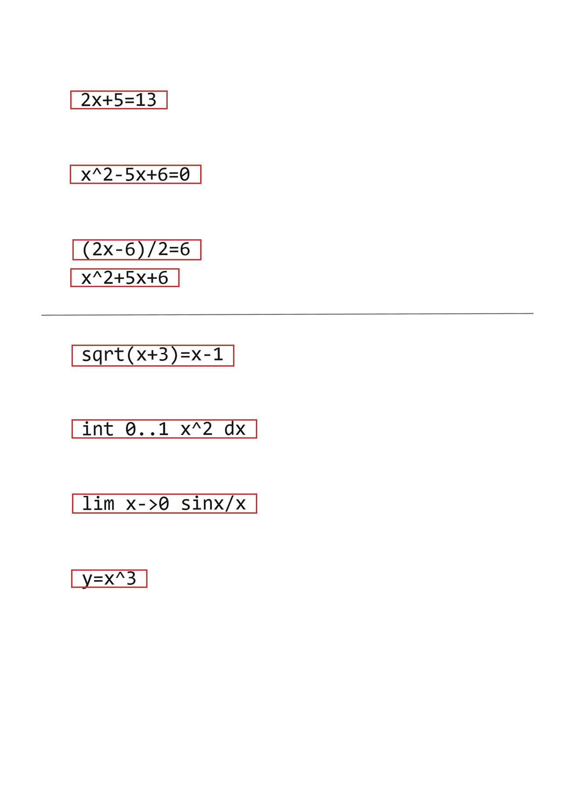

# 手写数据采集与自动切分方案

版本 v2 · 2026-11-09

---

## 0. 结论

- **一张 A4 写 10 行公式，整页拍一张，切行交给程序。** 不需要一题一张纸。
- 上一版"四个角必须在画面内"说的是**整张纸的四角**，用于确认整页没被裁切；它和"一题一页"没有关系，是我给的示例默认了一题一图，导致推论不合理。
- 200 条样本 = **20 张照片**，不是 200 张。

| | 一题一图（旧） | 整页 + 自动切行（新） |
|---|---|---|
| 拍摄次数 | 200 | 20 |
| 用纸 | 200 张 | 20 张 |
| 手工命名 | 200 次 | 20 次（页名） |
| 拍摄耗时（估） | ~27 min | ~3 min |
| 切分耗时 | 0 | ~30 s（自动） |
| 主要风险 | 无 | 切分错误，需抽查 |

---

## 1. 三层结构

数据采集要分清三个层级，混在一起就会得出"一页一题"这种结论。

| 层级 | 单位 | 由谁负责 | 要求 |
|---|---|---|---|
| **页层** | 一张 A4 照片 | 拍摄者 | 整页入画、纸四边可见、尽量正对、不裁切 |
| **行层** | 一行公式 | `tools/split_page.py` | 行间墨迹不接触 |
| **样本层** | 一张单行小图 | 切分产物 | 对应 `shotlist.csv` 的一个 id |

给识别模型的永远是最底的"样本层"，但采集只需在"页层"操作一次。**页层宽松，行层严格**，这是省力的关键。

页层为什么还要"纸的四边可见"？不是为了透视校正，而是为了**确认没拍到纸外**——一旦裁掉纸边，最上面那行可能只切到一半，而这种错误在缩略图上很难发现。纸边在画面里，相当于一个天然的完整性标记。

---

## 2. 采集规范 v2

### 2.1 写

| 项 | 要求 | 原因 |
|---|---|---|
| 纸 | A4 白纸，纯白无格 | 横线本的线会污染行投影；程序能抹，但多一层风险 |
| 笔 | 黑色签字笔或中性笔 | 铅笔反光、字迹浅，二值化后断裂 |
| 布局 | 页边距 2 cm，每行占 2.5 cm 竖向空间，从页顶 2 cm 起 | 257 mm 可用高度正好放 10 行 |
| 行距 | 墨迹之间净空 ≥ 8 mm | 唯一硬约束，见下 |
| 题号 | **不写** | 会被切进单行图，变成公式的一部分 |
| 字迹 | 按平时习惯写，不要刻意工整 | 工整样本测不出真实性能 |
| 字高 | 7–9 mm（约等于作业本书写大小） | 太大浪费行数，太小二值化易断 |

**唯一硬约束：上下两行的墨迹不能接触。** 具体包括：上一行分式的横线、根号的下沿、下标、以及连笔的尾巴，不能碰到下一行的字头。接触了就变成一条行带，算法只能靠"行带过高"去猜切点，误差大。

按 2.5 cm 行距、8 mm 字高，净空约 17 mm，是安全的。真正容易出问题的是**写大分式的时候**——`\frac{a+b}{c+d}` 这种上下结构会向下多占一层，写到 1.5 倍行高很正常。**遇到分式套分式的，单独留一行空间。**

### 2.2 拍

| 项 | 要求 |
|---|---|
| 设备 | 手机后置，不用前置（畸变大） |
| 姿态 | 竖直俯拍，镜头与纸面平行，纸占画面 70% 以上 |
| 倾斜 | ≤ 3°（程序纠偏范围 ±3°，超出请重拍） |
| 光线 | 自然光或柔光台灯，**避免单侧强光**（半页发黑，Otsu 会崩） |
| 对焦 | 点一下纸面中心再拍，别用自动微距 |
| 格式 | jpg，**不要用扫描 App**（会锐化 + 透视校正 + 加白边，与真实场景不一致） |
| 原图 | 不压缩、不美颜、不裁剪 |
| 遮挡 | 手指、笔、阴影不要进入纸面区域 |

iPhone 需把相机格式改成"兼容性最佳"，否则存的是 HEIC；改后缀没用，文件仍是 HEIC。

### 2.3 命名

```
data/inbox/page_01.jpg
data/inbox/page_02.jpg
...
```

页名对应 `data/pages.csv`，一张页覆盖一段连续 id：

```
page,lines,start_id,end_id,types
page_01,10,eq_001,eq_010,方程
page_02,10,eq_011,eq_020,方程
...
page_13,10,hard_001,hard_010,难例
```

拍摄时**不需要关心 train/test 划分**——切出来之后按 id 自动分流到 `data/self/` 和 `data/test/`。

---

## 3. 页 → 行 → 样本的映射

```
page_01.jpg
  ├─ 第 1 行 → eq_001.jpg
  ├─ 第 2 行 → eq_002.jpg
  │   ...
  └─ 第 10 行 → eq_010.jpg
```

映射规则：**自上而下，第 i 行 = 本页第 i 个 id。**

这条规则很脆弱：只要漏切或多切一行，后面全部错位。所以必须配一道校验——

> **行数校验**：`split_page.py` 切出 N 行，必须等于 `pages.csv` 里本页的 `lines`。
> 不等就报警（`--expect 10`），该页不进入后续流程，人工核对。

实际使用中，行数一致时按序映射；不一致时我看图重新对位，不硬套。

映射与分流由 `tools/route_crops.py` 完成，先用 `--dry-run` 看清映射再落盘：

```bash
F:/PyCharm/python.exe tools/route_crops.py --dry-run
# 计划  page_01_01.jpg → data/self/eq_001.jpg   (page_01 第1行)
# 计划  page_01_05.jpg → data/test/eq_005.jpg   (page_01 第5行)
# 共 8 张：self 7 张，test 1 张
# 警告：page_01 切出 8 行，pages.csv 声明 10 行
```

这组输出取自 4.4 的 8 行自测页，行数与声明的 10 行不符——正好演示校验该发挥作用的时候。

train/test 由 `labels.csv` 决定，拍摄者不需要关心。

---

## 4. 切分算法

### 4.1 流程

```
原图
 ├─ EXIF 转正 → 灰度 → 长边缩到 2400
 ├─ Otsu 自适应二值化（深底反色）
 ├─ 抹掉长横线（横线本的线）
 ├─ 纠偏：搜 −3°…+3°，取行投影平方和最大的角度
 ├─ 灰度图同步旋转（切图从灰度取，不取二值图）
 ├─ 水平投影剖面 + 平滑 → 取超过阈值的连续行带
 ├─ 行带合并（间距 < 页高 1.2%）
 ├─ 过高行带递归再切（> 1.6× 中位行高，在中段 30–70% 的最低谷下刀）
 └─ 按行带求横向墨迹范围 → 加留白 → 切图 + 写 manifest
```

### 4.2 参数

| 参数 | 默认值 | 作用 |
|---|---|---|
| 长边上限 | 2400 px | 检测分辨率，够用且快 |
| 二值化 | Otsu | 自适应光照，不用手调阈值 |
| 长横线清除 | 连续墨迹 ≥ 55% 页宽 | 抹掉横线本 |
| 纠偏搜索 | −3° ~ +3°，步长 0.5° | 覆盖手持拍摄的常见倾斜 |
| 行带阈值 | 峰值 × 3% | 区分墨迹行与纸面噪声 |
| 剖面平滑窗 | 页高 × 0.4% | 抑制单像素毛刺 |
| 行带最小高度 | 页高 × 0.8% | 滤掉污点和标点 |
| 行间距合并 | 页高 × 1.2% | 同一行内的上下标不会被切散 |
| 粘连再切 | 行高 > 1.6 × 中位行高 | 触发递归下刀 |
| 裁切留白 | 左右 2% 页宽、上下 12% 行高 | 给识别模型留上下文 |

可调参数暴露为命令行：`--threshold-ratio`、`--min-gap-ratio`、`--no-deskew`、`--expect`、`--debug`。

### 4.3 三个关键设计决定

**① 输出灰度图，不输出二值图。**
纠偏时如果从二值图取像素，笔画边缘的抗锯齿全没了，细笔画会断。正确做法是让灰度图跟着一起旋转，切图从灰度图取，二值图只用于算投影。

**② 用 Otsu，不用固定阈值。**
手机拍的照片明暗差很大，固定阈值 127 在背光下整片变黑白块。Otsu 按直方图自动找分界，代价是遇到"半页阴影"会失效——那属于拍摄问题，重拍比调算法划算。

**③ 不做四角透视校正。**
完整做法是检测纸的四角、算单应矩阵、拉正。但这需要角点检测（opencv）或人工点选四角，成本高。实测下来，**纠偏 + 水平投影对 5° 以内的透视畸变不敏感**，因为投影剖面对纵向拉伸不关心。所以这一层是可选增强，不是必需。

### 4.4 实测

合成测试页：A4 尺寸（1240×1754），8 行公式（其中第 3、4 行故意只隔 11 px，模拟粘连），一条贯穿整页的横线（模拟横线本），整页旋转 1.2°。

```
$ python tools/selftest_split.py
page_01.png: 8 行  纠偏 -1.0°

切出 8 张，预期 8 张
  行 1  y= 206-248  高 42  宽221
  行 2  y= 375-418  高 43  宽299
  行 3  y= 545-592  高 47  宽293
  行 4  y= 611-653  高 42  宽248
  ...
通过：行数一致，且无异常高行带
```

结果：8/8 全对，粘连的两行被正确分开，横线被抹掉未产生行带，倾斜从 1.2° 纠到 0.2° 残差。



图中红框即算法检测到的行带。注意第 3、4 行贴得很近但各自成框——这是 `split_tall` 在谷底补刀的结果；中间那条横线没有被框住，说明长横线清除生效了（调试图画在原图上，所以线还在，只是没参与投影）。

`--debug` 会输出画红框的调试图，肉眼一眼能看出框得准不准，这是质检的主要手段。

---

## 5. 质检流程

### 5.1 自动

| 检查 | 判据 | 处置 |
|---|---|---|
| 行数 | 切出的行数 ≠ `pages.csv` 的 `lines` | 该页标红，人工核 |
| 行高异常 | 某行高 > 3 × 平均行高 | 疑似粘连未切开 |
| 行高异常 | 某行高 < 0.5 × 平均行高 | 疑似标点/污点 |
| 宽高比 | 宽 / 高 < 0.6 | 疑似竖排结构或切歪 |
| 墨迹量 | 行带墨迹 < 30 px | 疑似噪声 |

### 5.2 人工

- 每页看一次 `--debug` 调试图，重点看红框是否完整包住公式、有没有框住两行
- 抽查比例不低于 10%（20 页抽 2 页逐张看）
- test 集（`hard_*`、`free_*`）**必须 100% 看图确认**

### 5.3 失败模式与处置

| 现象 | 原因 | 处置 |
|---|---|---|
| 两行被切成一行 | 墨迹真的接触（分母下探、上标粘连） | 重写该行，行距加大；程序侧可降 `--min-gap-ratio` |
| 一行被切成两行 | 大分式/根号与主体间净空 > 1.2% 页高 | 调大 `--min-gap-ratio`（如 0.02） |
| 多出空行 | 纸面污点、笔尖顿点 | 人工删除该 crop |
| 整行丢失 | 字迹过浅，二值化后消失 | 换笔重写；或调 `--threshold-ratio` 到 0.015 |
| 半页发黑 | 单侧强光 | 重拍，换柔光 |
| 边缘行被截断 | 拍摄时裁到纸外 | 重拍 |
| 框住手指/笔 | 遮挡 | 重拍 |

---

## 6. 命令

解释器用 PyCharm 自带的 3.12（已装 numpy / Pillow / sympy）：

```bash
# 单页
F:/PyCharm/python.exe tools/split_page.py data/inbox/page_01.jpg \
    --out data/crops --expect 10 --debug

# 整目录批量
F:/PyCharm/python.exe tools/split_page.py data/inbox \
    --out data/crops --expect 10 --debug

# 自测（合成一页并验证切分）
F:/PyCharm/python.exe tools/selftest_split.py
```

产物：

```
data/crops/
├── page_01_01.jpg … page_01_10.jpg
├── page_01_debug.jpg        只用于质检，不进数据集
└── manifest.csv             页名/行号/文件名/坐标
```

---

## 7. 已知局限

1. **行列混排不支持**（一行写多个式子、括号内多行矩阵）。一期排除，写成一列即可。
2. **页内有插图/几何图形**时，图形会被当成一行切出来。所以公式集和图形集要分页拍。
3. **倾斜 > 3° 时纠偏失效**，投影峰会糊，行带粘连概率上升——这是重拍门槛。
4. **手写连笔跨行**（上一行字尾甩到下一行）无法用投影法解决，只能重写。
5. 多栏排版（一页两列）不支持，会按整行宽切开。

以上 1、2、4、5 都属于"采集侧规避"，不是算法能补的——所以规范里的那条"行间墨迹不接触"是硬约束，其他都可以商量。

---

## 8. 附：脚本清单

| 脚本 | 作用 |
|---|---|
| `tools/split_page.py` | 整页切行主程序 |
| `tools/route_crops.py` | 按 id 把切好的单行图分流到 self / test |
| `tools/selftest_split.py` | 合成页自测，验证切分正确性 |
| `tools/make_pages.py` | 生成 `data/pages.csv`（页 ↔ id 段映射） |
| `tools/make_shotlist_md.py` | 生成可读版采集清单 |
| `tools/init_labels.py` | 从 `shotlist.csv` 生成 `labels.csv` |
| `data/check_data.py` | 标签与文件一致性检查 |
